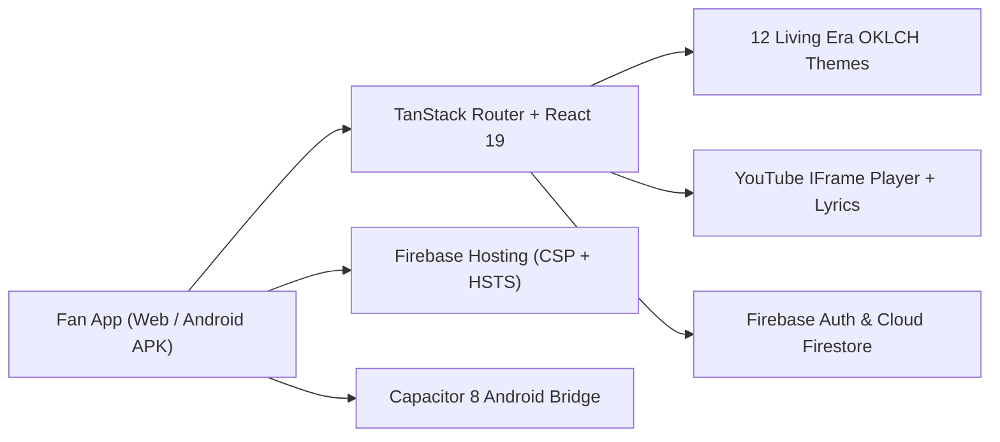

<div align="center">


# IVE: Dive Archive

**A mobile-first fan archive and music-discovery experience dedicated to IVE — built by a DIVE, for DIVEs.**

[](https://ive-dive-archive.web.app)
[](https://react.dev)
[](https://www.typescriptlang.org)
[](https://tailwindcss.com)
[](https://firebase.google.com)
[](https://capacitorjs.com)

<br />

[Live Web Preview](https://ive-dive-archive.web.app) · [Features](#-features) · [Tech Stack](#-tech-stack) · [Getting Started](#-getting-started) · [Disclaimer](#-copyright--fan-disclaimer)

</div>

---

## Overview

**IVE: Dive Archive** brings IVE's discography, member profiles, era aesthetics, and music discovery together in a sleek, native-feeling mobile and web application. Designed to feel like a dedicated K-pop streaming and fandom companion rather than a generic webpage, it pairs glassmorphism UI and smooth micro-interactions with album-inspired **Living Era Themes**.

> **Project Status:** Currently in active pre-release development (`v1.0.0`). Features, catalog entries, and polish are continuously evolving before wider public release.

---

## Features

| Feature                    | Highlights                                                                                                                                                                                                                         |
| :------------------------- | :--------------------------------------------------------------------------------------------------------------------------------------------------------------------------------------------------------------------------------- |
| **12 Living Era Themes**   | Switch between the signature midnight-violet palette and **11 album-inspired era themes** powered by OKLCH design tokens with radial theme-transition animations.                                                                  |
| **Music Player & Lyrics**  | Embedded **YouTube IFrame** playback from official IVE / Starship channels, featuring a persistent mini-player, full-screen expanded player, shuffle/repeat queue, and **Original + Romanized lyrics** (referenced from AZLyrics). |
| **2021–2026 Discography**  | Browse Korean, Japanese, and global releases with rich album artwork, release metadata, tracklists, and quick play actions.                                                                                                        |
| **6 Member Dossiers**      | Dedicated profiles for **An Yujin, Gaeul, Rei, Jang Wonyoung, Liz, and Leeseo** with interactive cards and live next-birthday countdowns.                                                                                          |
| **Latest News Dispatches** | Curated feed of IVE comebacks, milestones, and updates right from the Home screen.                                                                                                                                                 |
| **Cloud-Synced Favorites** | Save favorite tracks and playback preferences locally and sync seamlessly via **Firebase Anonymous Authentication**.                                                                                                               |
| **Web + Android Ready**    | Hosted on **Firebase Hosting** with hardened CSP/HSTS headers and packaged for Android via **Capacitor 8** (including hardware back-button handling and native media-session controls).                                            |

---

## Tech Stack

| Layer                 | Technologies                                                                        |
| :-------------------- | :---------------------------------------------------------------------------------- |
| **Frontend**          | React 19, TypeScript, Tailwind CSS v4, Lucide Icons                                 |
| **Routing & Data**    | TanStack Router, TanStack Query                                                     |
| **Backend & Hosting** | Firebase Hosting, Cloud Firestore, Firebase Anonymous Auth                          |
| **Media & Lyrics**    | YouTube IFrame API (Official IVE / Starship embeds), AZLyrics reference             |
| **Mobile**            | Capacitor 8 (`@capacitor/android`, `app`, `haptics`, `splash-screen`, `status-bar`) |

### Architecture



---

## Getting Started

### Prerequisites

- **Node.js** 20+ and **npm**
- A Firebase project configured in `.env` (`VITE_FIREBASE_*` environment variables)
- **Android Studio** (only if building or running the Android APK)

### Local Web Development

```bash
# 1. Install dependencies
npm install

# 2. Start the development server
npm run dev
```

### Production & Android Build

```bash
# Type-check & lint
npx tsc --noEmit
npm run lint

# Build the mobile/SPA bundle & sync with Android
npm run build:mobile
npx cap sync android

# Open in Android Studio
npx cap open android
```

---

## About the Developer

Made with love by **[@Nadzz677](https://github.com/Nadzz677)** — a 19-year-old developer and fellow DIVE who built this archive purely out of passion to help fans and newcomers explore IVE's eras, members, discography, and lyrics in one place.

- **GitHub:** [@Nadzz677](https://github.com/Nadzz677)
- **Contact / Takedown Requests:** `nadzhaa254@gmail.com`

---

## Copyright & Fan Disclaimer

- **Non-Commercial Fan Project:** **IVE: Dive Archive** is an unofficial, non-profit fan project and is **not affiliated with, endorsed by, or sponsored by** IVE, Starship Entertainment, Kakao Entertainment, Columbia Records, or Sony Music Japan.
- **Audio & Lyrics Attribution:** All music playback is streamed via official **YouTube IFrame embeds** from IVE / Starship Entertainment channels (no downloadable audio files are hosted or distributed). Original and Romanized lyrics are referenced from **AZLyrics** for personal fandom enjoyment and educational reference.
- **Support IVE Officially:** Playback in this app does **not** count toward official Korean or global music charts or music-show voting. Please continue supporting IVE on official platforms!
